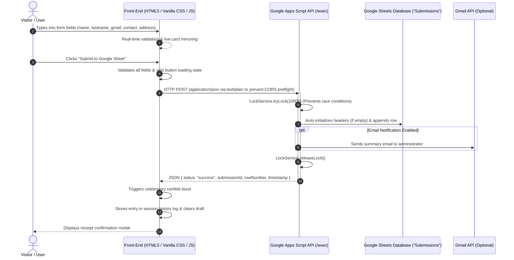

# Portfolio Connect: Comprehensive Technical Documentation

**Project:** Portfolio Contact & Lead Intake System  
**Repository:** [https://github.com/itsmeawi/Portfolio.git](https://github.com/itsmeawi/Portfolio.git)  
**Database:** [Google Spreadsheet (ID: `1ZBKFAWajAClVhBj17anFys4ACJGHy9NJBof75dew_iQ`)](https://docs.google.com/spreadsheets/d/1ZBKFAWajAClVhBj17anFys4ACJGHy9NJBof75dew_iQ/edit)  
**Active Endpoint:** `https://script.google.com/macros/s/AKfycbyhmon-zEpPQQh2zNL34b3WEQkG6_mEalmB3dK2QMwZxJ5yAniWRCgr4te2ehB24wwwAg/exec`  
**Version:** 1.0.0  

---

## 1. Executive Summary & Architecture

**Portfolio Connect** is a serverless lead intake and contact portal designed for personal portfolios and professional websites. It captures user inquiries through an interactive front-end interface and persists records directly into a private **Google Spreadsheet** using **Google Apps Script (GAS)** as a serverless RESTful API.

### 1.1 High-Level Architecture Diagram



### 1.2 Technology Stack

| Layer | Technology | Rationale |
| :--- | :--- | :--- |
| **Structure** | Semantic HTML5 | Accessible landmarks, proper label associations, ARIA attributes. |
| **Styling** | Vanilla CSS3 (Vectr-Grade) | Dark industrial tones (`#06080f`/`#0b0f19`), electric cyan accents, spotlight mouse tracking. |
| **Logic** | Modern ES6+ JavaScript | Zero external frameworks; fast loading, async fetch, modular functions. |
| **Kinetics & Motion** | GSAP 3.12.5 & ScrollTrigger | Cinematic staggered load timeline, batch scroll reveals, magnetic button physics. |
| **Celebrations** | Canvas Confetti (CDN) | Lightweight celebratory micro-interaction upon verified submission. |
| **Backend** | Google Apps Script (V8 Engine) | Zero-cost serverless execution, direct access to Google Workspace APIs. |
| **Database** | Google Sheets | Instant spreadsheet database with real-time rows, zero hosting fees. |
| **Version Control** | Git & GitHub | Distributed version control on branch `main`. |

---

## 2. Repository & File Inventory

```
Portfolio/
├── index.html        # Main web interface (Form, Live Preview, Setup Drawer, Modals)
├── styles.css        # Glassmorphism design system, ambient neon orbs, responsiveness
├── app.js            # Client-side validation, live mirroring, GAS fetch dispatch, history
├── Code.gs           # Production Google Apps Script backend code (deployed on Google Drive)
├── documentation.md  # Comprehensive technical system documentation (this file)
├── README.md         # Quick-start guide and deployment walkthrough
└── .gitignore        # Standard Git exclusion patterns
```

---

## 3. Data Dictionary & Form Field Specifications

The form validates and captures five core lead fields, along with auto-generated metadata:

| Field Key | Label | Input Type | Validation Rules | Description & Transformation |
| :--- | :--- | :--- | :--- | :--- |
| `name` | First Name | `text` | Required, min 2 chars, max 50 chars | Trims whitespace; feeds first initial to preview badge. |
| `lastname` | Last Name | `text` | Required, min 2 chars, max 50 chars | Trims whitespace; feeds second initial to preview badge. |
| `gmail` | Gmail Address | `email` | Required, valid email format regex | Verifies `^[^\s@]+@[^\s@]+\.[^\s@]+$`. Includes 1-click `+ @gmail.com` autofill helper. |
| `contact` | Contact Number | `tel` | Required, 7–15 numeric digits | Preserves leading `+` for international country codes, formats digits automatically. |
| `address` | Complete Address | `textarea` | Required, min 5 chars, max 250 chars | Preserves newlines/unit details; live character counter (`0 / 250`). |
| *`timestamp`* | *Timestamp* | *System* | ISO 8601 string | Generated by client and recorded by Google Apps Script server. |
| *`submissionId`* | *Submission ID* | *System* | `SUB-YYYYMMDD-HHMMSS-XXX` | Unique transaction ID generated in Google Apps Script. |
| *`userAgent`* | *User Agent* | *System* | Browser UA string | Captured for debugging and client device auditing. |

---

## 4. Backend Engineering: Google Apps Script (`Code.gs`)

The backend script resides in the Google Spreadsheet container under **Extensions > Apps Script**.

### 4.1 Key Backend Features

1. **Dual Resolution (Bound or Standalone):**
   ```javascript
   var ss = SpreadsheetApp.getActiveSpreadsheet();
   if (!ss) {
     ss = SpreadsheetApp.openById(SPREADSHEET_ID);
   }
   ```
   Works regardless of whether the script is container-bound or standalone.

2. **Concurrency Safety (`LockService`):**
   Prevents simultaneous form submissions from interleaving or overwriting rows by acquiring a script lock for up to 10 seconds:
   ```javascript
   var lock = LockService.getScriptLock();
   var lockAcquired = lock.tryLock(10000);
   ```

3. **Automatic Sheet & Header Provisioning:**
   If the target tab `"Submissions"` does not exist, it is created. If row 1 is empty, headers are appended and styled automatically:
   - Header background color: `#1e1b4b` (Deep Indigo)
   - Font: White, Bold, Centered
   - Frozen header row: `sheet.setFrozenRows(1)`
   - Column auto-resizing: `sheet.autoResizeColumn(col)`

4. **Telephone Format Preservation:**
   To prevent Google Sheets from interpreting international phone numbers (e.g. `+63 912 345 6789`) as mathematical formulas or stripping leading zeros, values are prefixed with a text escape apostrophe:
   ```javascript
   "'" + contact
   ```

5. **JSON API Response with CORS Support:**
   Both `doGet` and `doPost` return a valid `ContentService.createTextOutput` with `ContentService.MimeType.JSON`.

---

## 5. Front-End Architecture & User Experience

### 5.1 Real-Time Live Mirroring
As the user types into any field, `updateLivePreview()` executes immediately:
- **Full Name Sync:** Concatenates First Name and Last Name with graceful fallback to `"Your Name Here"`.
- **Avatar Initials:** Generates a dynamic uppercase badge (e.g. "John Doe" $\rightarrow$ `JD`).
- **Dynamic Clock:** Displays a real-time running clock showing local user time.

### 5.2 Auto-Draft Saving & Crash Recovery
To avoid frustrating data loss if a visitor accidentally refreshes the page:
- Form state is automatically saved into `sessionStorage` under the key `portfolio_form_draft` on every keystroke.
- Upon reload, `loadDraft()` restores the input fields and character counts seamlessly.
- Upon successful submission, `clearDraft()` clears the stored data.

### 5.3 CORS Mitigation Strategy
Google Apps Script Web Apps redirect (HTTP 302) to `script.googleusercontent.com`. Standard CORS preflight (`OPTIONS`) requests will fail against Google Apps Script endpoints.
To bypass this limitation without needing an intermediary proxy:
1. The client sends requests using `Content-Type: text/plain;charset=utf-8` with a stringified JSON body.
2. Browsers treat `text/plain` as a "simple request", omitting the preflight `OPTIONS` check.
3. The Google Apps Script `doPost(e)` parses `e.postData.contents` via `JSON.parse()`.
4. As a secondary failsafe, if a network error occurs, `app.js` falls back to `mode: 'no-cors'`.

### 5.4 Celebration & Feedback Loop
- **Canvas Confetti:** Dual side cannons and center burst upon HTTP 200/success response.
- **Submission Receipt Modal:** Displays the exact recorded values with the unique `Submission ID`.
- **History Drawer:** Preserves recent session submissions with timestamps in `localStorage`.

---

## 6. API Reference

### 6.1 Form Submission (`POST /exec`)

**Endpoint:**
```
https://script.google.com/macros/s/AKfycbyhmon-zEpPQQh2zNL34b3WEQkG6_mEalmB3dK2QMwZxJ5yAniWRCgr4te2ehB24wwwAg/exec
```

**Request Headers:**
```http
Content-Type: text/plain;charset=utf-8
```

**Request Payload:**
```json
{
  "name": "Jane",
  "lastname": "Smith",
  "gmail": "jane.smith@gmail.com",
  "contact": "+1 (555) 987-6543",
  "address": "456 Innovation Way, Suite 12, San Francisco, CA 94105",
  "timestamp": "2026-10-17T14:22:33.345Z",
  "userAgent": "Mozilla/5.0 (Windows NT 10.0; Win64; x64) ..."
}
```

**Success Response (HTTP 200 OK):**
```json
{
  "status": "success",
  "message": "Form submission saved successfully!",
  "submissionId": "SUB-20261017-222233-415",
  "rowNumber": 3,
  "timestamp": "2026-10-17T14:22:33.345Z"
}
```

**Error Response:**
```json
{
  "status": "error",
  "message": "Missing required form data (Name and Gmail are required)."
}
```

---

### 6.2 Health Check (`GET /exec`)

Used by the built-in **Test Connection** button in the web settings modal.

**Success Response (HTTP 200 OK):**
```json
{
  "status": "active",
  "message": "Google Apps Script Form Service is running successfully!",
  "timestamp": "2026-10-17T14:20:00.000Z"
}
```

---

## 7. Deployment & Operational Runbook

### 7.1 How to Update or Redeploy `Code.gs`

When modifying `Code.gs` in Google Apps Script, you **must create a new version** for the changes to reflect on the `/exec` URL:

1. Open your [Google Spreadsheet](https://docs.google.com/spreadsheets/d/1ZBKFAWajAClVhBj17anFys4ACJGHy9NJBof75dew_iQ/edit).
2. Go to **Extensions > Apps Script**.
3. Make your edits and click **Save** (`Ctrl+S`).
4. Click **Deploy > Manage deployments**.
5. Select the active deployment (pencil icon to edit).
6. Under **Version**, select **New version**.
7. Click **Deploy**. *(The Web app URL remains identical).*

### 7.2 Hosting the Front-End

The front-end is completely static and can be deployed anywhere:

#### Option A: GitHub Pages (Recommended)
1. Go to your repository settings on GitHub: `https://github.com/itsmeawi/Portfolio/settings/pages`.
2. Under **Build and deployment > Source**, select **Deploy from a branch**.
3. Choose branch `main` and folder `/ (root)`.
4. Click **Save**. Your site will be live at `https://itsmeawi.github.io/Portfolio/`.

#### Option B: Local Development
Run with the built-in Node server:
```powershell
node -e "const http=require('http'),fs=require('fs'),path=require('path');const mime={'html':'text/html','css':'text/css','js':'application/javascript'};http.createServer((req,res)=>{let p=path.join(process.cwd(),req.url==='/'?'index.html':req.url.split('?')[0]);fs.readFile(p,(e,d)=>{if(e){res.writeHead(404);res.end();}else{res.writeHead(200,{'Content-Type':mime[path.extname(p).slice(1)]||'text/plain'});res.end(d);}});}).listen(3000,()=>console.log('http://localhost:3000/'));"
```

---

## 8. Security & Maintenance Considerations

1. **CORS & Access Permissions:**  
   The Apps Script Web App must remain configured with:
   - **Execute as:** `Me`
   - **Who has access:** `Anyone`  
   This allows form visitors to append rows without requiring a Google OAuth consent screen.
2. **XSS Sanitization:**  
   All dynamic values rendered into the DOM (e.g. recent submission history and receipts) are sanitized through `escapeHtml()` to mitigate cross-site scripting risks.
3. **Google Sheets Quotas:**  
   Free Google accounts have a limit of **20,000 URL Fetch calls/day** and **100 email notifications/day**. For standard portfolio contact volumes, this easily covers production demands.
4. **Data Privacy:**  
   Only the spreadsheet owner and collaborators with explicit Google Drive sharing permissions can view the accumulated contact records in the Google Sheet.

---

## 9. Cinematic UX & Architectural Features (Michael Gatt Mechanics)

The portfolio incorporates award-winning interaction design patterns inspired by **Michael Gatt** (`michaelgatt.com`):

### 9.1 Web Audio API Haptic Soundscape
- **Zero Audio Assets**: Built purely with native browser `AudioContext` and frequency synthesis.
- **Opt-In / Muted by Default**: Fully complies with browser autoplay restrictions; toggleable via the navbar pill button (`#audioToggleBtn`) or the `M` key.
- **Tactile Sound Map**:
  - `playClick()`: 720Hz sine blip (35ms) for all interactive buttons and navigation links.
  - `playInputFocus()`: 480Hz triangle tone (25ms) when focusing input fields.
  - `playSuccessChord()`: Ascending 4-frequency arpeggio (`C5, E5, G5, C6`) on verified Google Sheet row insertion.
  - `playError()`: Dissonant dual-tone alert (220Hz $\rightarrow$ 180Hz) on form validation errors.
  - `playDrawerOpen()` / `playDrawerClose()`: Fluid slide frequency sweeps.

### 9.2 2.5D Architecture Canvas Topology
- Toggleable in the **Selected Works** section via `[ Grid View ]` vs. `[ 2.5D Topology Map ]`.
- Interactive spatial node graph rendering 6 interconnected systems:
  - *EdgeMesh Gateway* (Anycast PoP)
  - *Client Browser UI* (Vectr SPA)
  - *Portfolio Connect* (Google Apps Script Webhook)
  - *Google Sheets DB* (Row Persist)
  - *AetherOS Core* (Raft Consensus)
  - *QuantumLedger* (SHA-256 Merkle WASM)
- Features animated glowing packet streams, mouse drag-to-pan physics, node hover glow, and click-node-to-inspect.

### 9.3 Slide-out Project Deep-Dive Inspector Drawer
- A persistent glassmorphism side drawer (`#projectDrawer`) inspired by Michael Gatt's persistent media layer.
- Accessible from both the project cards ("Inspect Architecture") and the 2.5D node map.
- Features tabbed technical inspection:
  - **01 // Architecture**: ASCII data-flow diagrams, system overview, and core architectural metrics.
  - **02 // Live Telemetry & Ping**: Real-time probe test button measuring round-trip latency against the live Google Apps Script endpoint (or simulated edge backplanes) with animated progress gauges.
  - **03 // Solved Challenges**: Deep dives on engineering hurdles (CORS preflight workarounds, concurrency locks, WebAssembly hashing, and split-brain prevention).

### 9.4 Keyboard Shortcuts & Accessibility
- `Escape`: Instantly dismisses active drawers, configuration settings, or receipt modals.
- `M`: Toggles the synthesized haptic soundscape on/off from anywhere on the page.
- `prefers-reduced-motion`: Automatically disables canvas particle animations and uses instant transitions.

