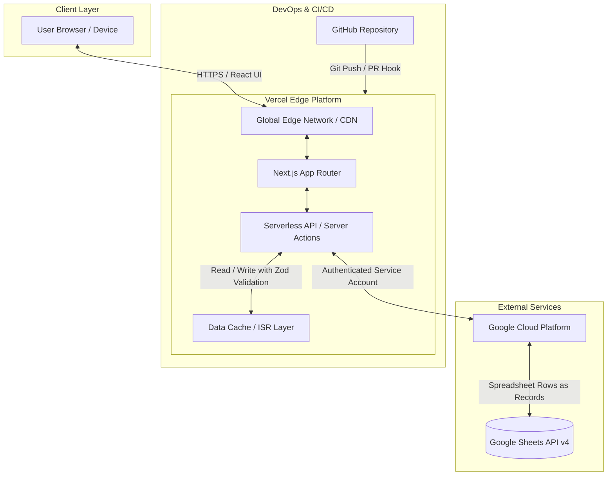

# Technical & Project Proposal
## Fullstack Web Application Development

**Project:** Custom Web Application Solution  
**Prepared by:** Fullstack TypeScript Developer  
**Status:** Proposal / Draft  
**Target Stack:** TypeScript · Google Sheets API · GitHub · Vercel  

---

## 1. Executive Summary

This proposal outlines the end-to-end design, implementation, and deployment strategy for a modern, high-performance web application. The proposed architecture pairs the robustness of **TypeScript** with the agility of **Google Sheets as a backend/CMS**, backed by continuous integration through **GitHub** and serverless edge delivery on **Vercel**.

### Key Value Proposition
- **Zero Database Infrastructure Overhead:** Eliminates recurring database hosting expenses (RDS, MongoDB Atlas, PostgreSQL) by leveraging Google Sheets via the Google Sheets API v4.
- **Client Autonomy & Accessibility:** Non-technical stakeholders can view, audit, manage, and export data directly through the familiar Google Sheets interface without requiring a custom admin dashboard.
- **Type-Safe Fullstack Architecture:** End-to-end type safety from API payloads to UI components ensures fewer runtime bugs, faster iteration, and strict data validation.
- **Global Serverless Performance:** Deployed on Vercel's Edge Network with automated CI/CD directly linked to GitHub repository branches, guaranteeing sub-second response times and 99.99% uptime.

---

## 2. Technology Stack & Architectural Rationale

| Layer | Technology | Primary Rationale & Benefits |
| :--- | :--- | :--- |
| **Language & Core** | **TypeScript** | Strict type safety, interface contracts, automated intellisense, fewer production runtime errors, and seamless refactoring. |
| **Fullstack Framework** | **Next.js (App Router) / React** | Native Server Components (RSC), built-in Server Actions, API routes, and Incremental Static Regeneration (ISR) to cache sheet responses. |
| **Database / CMS** | **Google Sheets API v4** | Instant live spreadsheet interface, zero maintenance, built-in revision history, and easy CSV/Excel exports for team members. |
| **Validation Layer** | **Zod** | Enforces strict schema validation before data is written to or parsed from Google Sheets rows. |
| **Source Control & CI/CD** | **GitHub** | Version control, collaborative code reviews via Pull Requests, branch protection rules, and automated Vercel preview environments. |
| **Hosting & Deployment** | **Vercel** | Automated zero-downtime deployments, global CDN edge caching, serverless function execution, and environment variable security. |

---

## 3. System Architecture & Data Flow



### Data Flow Overview
1. **Read Requests:** The client requests data. Next.js Server Components query the Google Sheets API using service account credentials. Responses are cached via Incremental Static Regeneration (ISR) or in-memory tag caching to respect Google Sheets rate limits and maximize page load speeds.
2. **Write Requests:** Form submissions are dispatched via Server Actions or REST endpoints. Data is validated against strict **Zod schemas**. Once validated, rows are appended or modified in Google Sheets.
3. **Data Cache Revalidation:** On successful mutation, relevant cache tags (`revalidateTag`) are purged to ensure the client immediately receives updated records.

---

## 4. Google Sheets Database Architecture

Using Google Sheets as a relational-style datastore requires structured design and schema discipline:

### Tab Organization Strategy
- Each sheet tab functions as a **table/collection** (e.g., `Users`, `Inquiries`, `Products`, `Orders`, `Settings`).
- **Row 1:** Reserved for strict column headers matching TypeScript schema property keys.
- **Row 2 onward:** Data records with unique identifier generation (UUID or sequential ID).

```
Spreadsheet: "Production_Database"
├── Sheet Tab: "Inquiries"    [id | created_at | name | email | message | status]
├── Sheet Tab: "Subscribers"  [id | timestamp  | email | source | active]
└── Sheet Tab: "Metadata"     [key | value | last_updated]
```

### Rate Limiting & Quota Management
Google Sheets API enforces a quota of:
- **300 read requests per minute per project**
- **300 write requests per minute per project**
- **60 requests per minute per user**

**Mitigation & Optimization Strategies:**
- **Aggressive Caching (ISR):** Public read-heavy pages are cached statically and revalidated periodically (e.g., `revalidate: 60`), reducing Google Sheets API calls by up to 95%.
- **Batching Operations:** Write actions and bulk queries use `batchGet` and `batchUpdate` methods rather than individual cell requests.
- **Optimistic UI Updates:** Client-side updates show instant feedback while asynchronous write queues handle persistence in the background.

---

## 5. Security & Authentication Strategy

1. **Google Service Account Authentication:**
   - Server-to-server communication using private keys (`service_account.json` or base64 environment variable).
   - No Google credentials or tokens are ever exposed to the client browser.
   - The spreadsheet is shared only with the dedicated service account email with least-privilege permissions (`Editor` or `Viewer`).
2. **Environment Variable Protection:**
   - Credentials (`GOOGLE_SERVICE_ACCOUNT_EMAIL`, `GOOGLE_PRIVATE_KEY`, `GOOGLE_SHEET_ID`) are encrypted and managed exclusively in **Vercel Project Settings**.
3. **Input Sanitization & Injection Prevention:**
   - Spreadsheet injection attacks (formulas starting with `=`, `+`, `-`, `@`) are stripped or escaped prior to writing to the sheet.
   - Zod runtime type-checking guarantees correct types (strings, numbers, timestamps) before network transmission.

---

## 6. Scope of Work & Deliverables

### Milestone 1: Discovery & Architecture Setup (Days 1–3)
- [x] GitHub repository setup with branching strategy (`main`, `staging`, feature branches).
- [x] GCP Project initialization, Google Sheets API enablement, and Service Account configuration.
- [x] Vercel project linkage with automated preview environments for pull requests.
- [x] Baseline Next.js + TypeScript scaffolding, ESLint, Prettier, and styling framework configuration.

### Milestone 2: Google Sheets ORM/Data Access Layer (Days 4–7)
- [x] Implementation of type-safe Google Sheets client utility (`google-spreadsheet` or official `@googleapis/sheets`).
- [x] CRUD helper abstraction layer (Create, Read, Update, Delete row operations).
- [x] Zod validation models for all entity types.
- [x] Revalidation and caching pipeline configuration.

### Milestone 3: Frontend & Application Features (Days 8–14)
- [x] Fully responsive UI/UX designed with modern typography, smooth interactions, and mobile-first layout.
- [x] Form submission handlers with client-side and server-side validation.
- [x] Real-time / optimistic UI updates upon sheet mutation.
- [x] Error boundary and loading skeleton implementations.

### Milestone 4: QA, Performance & Security Hardening (Days 15–17)
- [x] Google Sheets quota load testing and error recovery fallbacks.
- [x] Spreadsheet formula injection sanitization.
- [x] Lighthouse audit for Performance, Accessibility, Best Practices, and SEO (Target: 95+ score).
- [x] Cross-browser and responsive testing across mobile, tablet, and desktop.

### Milestone 5: Production Launch & Documentation (Days 18–20)
- [x] Production deployment to Vercel custom domain with SSL certification.
- [x] Client handover documentation (spreadsheet maintenance guide, backup recommendations).
- [x] Post-launch monitoring and bug-fix warranty.

---

## 7. Cost & Infrastructure Estimates

| Item | Service | Estimated Monthly Cost |
| :--- | :--- | :--- |
| Database / CMS | Google Sheets (via Google Workspace / Personal Account) | **$0.00 / month** |
| Hosting & CDN | Vercel (Hobby / Pro tier) | **$0.00 - $20.00 / month** |
| Version Control & CI/CD | GitHub (Public / Private Repositories) | **$0.00 / month** |
| API & Auth Engine | Google Cloud Platform (Within free quota) | **$0.00 / month** |
| **Total Estimated Infrastructure Overhead** | | **~$0.00 to $20.00 / month** |

*Note: Competing architectures requiring dedicated SQL/NoSQL databases and container hosting typically start at $50–$150/month. This stack yields maximum cost efficiency.*

---

## 8. Development Standards & Quality Assurance

- **Code Quality:** 100% TypeScript with strict null checks (`strict: true`). Zero implicit `any` types.
- **Version Control Workflow:** Trunk-based development with feature branches; all code merged via PRs validated by Vercel Preview Deployments.
- **Monitoring & Analytics:** Vercel Web Analytics and Speed Insights enabled for real-time telemetry.

---

## 9. Next Steps & Approval

To commence work on this project, please review and approve the proposal:

1. **Sign-off:** Confirmation on project scope and milestones.
2. **Access Provisioning:**
   - Invitation to Google Sheet / Google Cloud Console or creation authorization.
   - GitHub organization / repository collaboration access.
   - Vercel team account or deployment access.
3. **Kickoff:** Sprint 1 commences immediately upon credential provisioning.

**Developer Contact:** Fullstack TypeScript Engineer  
**Repository:** [GitHub Project Repository URL]  
**Deployment Preview:** [Vercel Deployment URL]  
